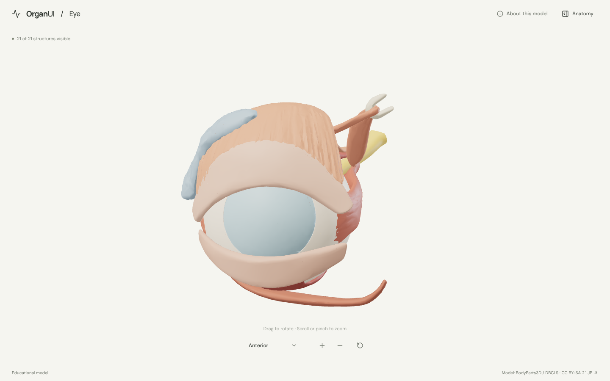
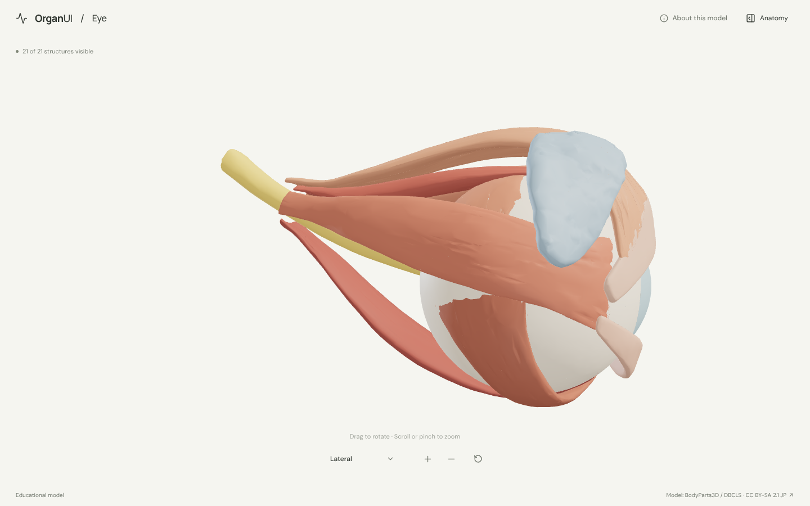
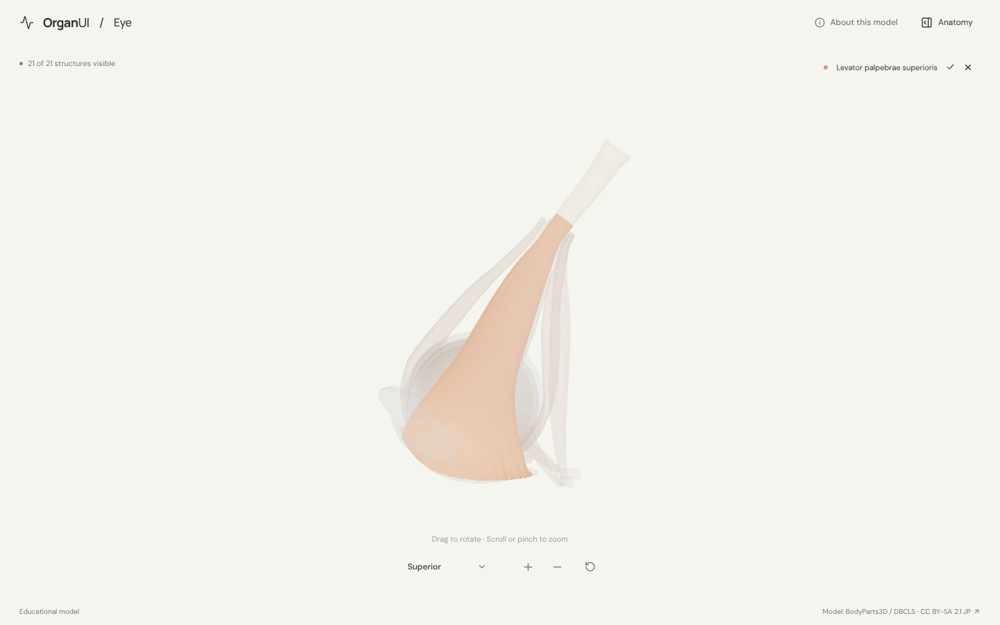
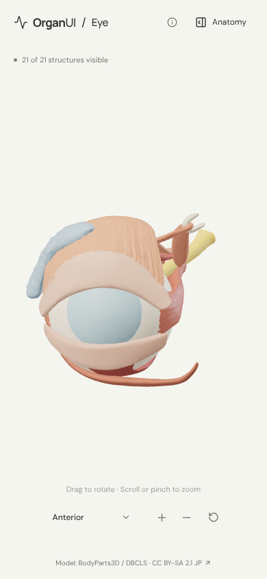

# OrganUI Eye

A minimal, standalone, open-source eye anatomy explorer built with React, TypeScript, Three.js, React Three Fiber, Vite, and Bun.

**Status:** working local demo. Twenty-one selectable structures of the right eye and orbit, a real bundled model, responsive layouts, and desktop/mobile browser checks. Public deployment and clinical anatomy review have not been completed.



## Run locally

Install [Bun](https://bun.sh/) **1.4.2 or newer**, then:

```sh
git clone https://github.com/organui/eye-3d.git
cd eye-3d
bun install --frozen-lockfile
bun run dev
```

Open **http://127.0.0.1:5173**. No environment variables, accounts, API keys, sibling repositories, model downloads, or external font services are needed after dependency installation. The ready-to-use 3.9 MB GLB is in `public/models/`.

```sh
bun run typecheck       # TypeScript checks, including conversion scripts
bun run test            # Unit tests for selection emphasis, picking, and the anatomy-tree adapter
bun run verify:model    # Check the GLB hash, source IDs, and valid geometry
bun run build           # Typecheck and create dist/
bun run preview         # Serve the production build at http://127.0.0.1:4173
bun run format:check    # Check formatting of application and preparation code
```

The app is static and uses relative build paths. No deployment has been performed.

## Explore

The explorer shares its behaviour with the other OrganUI explorers ([heart](https://github.com/organui/heart-3d) is the reference):

- The eye opens in the anterior view. Drag to rotate; scroll or pinch to zoom. The toolbar holds the view menu (**Anterior**, **Lateral**, **Superior**), zoom in, zoom out, and reset. Manual rotation changes the label to **Custom view**; zooming and selecting keep it.
- Select a structure in 3D or in the **Anatomy** panel (the OrganUI registry `anatomy-tree`). The selection glows in its own colour and everything else is ghosted. A chip above the canvas names the selection; its name opens the panel.
- The panel is closed by default and opens from the header **Anatomy** button. Escape or close returns focus to the toggle. Search, group visibility (with **Mixed** state), Isolate, Hide, and Restore all are available.
- A five-stop guided exploration goes from the cornea through the lens and retina to the eye muscles and optic nerve.
- Keyboard: Tab/Enter for controls; focus the model and use arrow keys to rotate, `+`/`-` to zoom. All anatomy text is available without WebGL. Reduced-motion preferences disable damping.

<details>
<summary>Lateral view, selection, and mobile screenshots</summary>







</details>

## Model, credits, and review status

> BodyParts3D / Anatomography, © The Database Center for Life Science (DBCLS). Licensed under [CC BY-SA 2.1 Japan](https://creativecommons.org/licenses/by-sa/2.1/jp/deed.en).

The model is a curated subset of **BodyParts3D 4.3**: 23 original meshes of the right eye, grouped into 21 structures (cornea, sclera, choroid, retina, iris, anterior chamber, lens, suspensory ligament, vitreous body, the six extraocular muscles and levator palpebrae superioris, optic nerve, trochlea, lacrimal gland, and both tarsal plates). Meshes come from a commit-pinned public mirror; every file is checked against its pinned SHA-256, its embedded identifiers, and the official 4.3 concept table. The model's share-alike license is separate from this repository's **MIT code license**, and is not the CC BY 4.0 grant that covers the 4.0 archive `heart-3d` uses.

Read [model provenance and preparation](docs/MODEL_PROVENANCE.md), the [runtime license notice](public/models/LICENSE.txt), and the [checksum/mapping manifest](public/models/manifest.json). Fonts are bundled locally under the SIL Open Font License; [third-party notices](public/licenses/README.md) ship with the build.

Descriptions are short original summaries, linked to the National Eye Institute in the interface. **Expert anatomical review is pending.** This is an educational interface demonstration, not a diagnostic tool or a simulation of vision.

Known limitations:

- One simplified adult reference eye. The ciliary body, orbital bones, eyelid soft tissue, tear ducts, vessels, and the left eye are omitted. Colors are illustrative and clear media are tinted.
- 36 faces forming tiny detached fragments at the left eye's position were removed from four source meshes; nothing else was reshaped.
- With every other structure ghosted, deep structures (lens, retina) sit behind several translucent layers and are faint. Isolate them, or hide outer layers, for a clear look.
- Browser checks used headless desktop and mobile Chromium with software WebGL, not physical devices or a screen-reader audit.
- The Three.js/Fiber production chunk is about 793 kB before compression (209 kB gzip); Vite reports a size advisory.

## Reproduce the model

```sh
bun run prepare:model
bun run verify:model
```

This downloads the 23 pinned meshes (about 11 MB) into ignored `.asset-cache/` only when they are absent, verifies them, and writes the GLB plus manifest.

## Implementation

- `src/anatomy.ts`: source-ID mappings, text, views, and guided stops.
- `src/App.tsx`, `src/Viewer.tsx`, `src/ViewMenu.tsx`, `src/SceneCanvas.tsx`: shared explorer shell from `heart-3d`.
- `src/framing.ts`: identical to every OrganUI explorer's copy; named views fit sampled surface points to the frame.
- `src/components/ui/anatomy-tree.tsx`: OrganUI registry component installed with the shadcn CLI, tracked unmodified ([details](docs/REGISTRY_INTEGRATION.md)).
- `src/anatomy-adapter.ts`: tree data and visibility mapping for this scene.
- `scripts/`: pinned inputs, reproducible conversion, and runtime validation.

## License

Original application code: [MIT](LICENSE). The anatomy model, derived model images, fonts, and icons keep their separately documented licenses.

Part of [OrganUI](https://github.com/organui).
